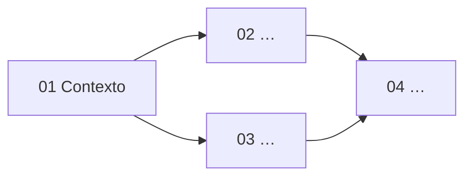
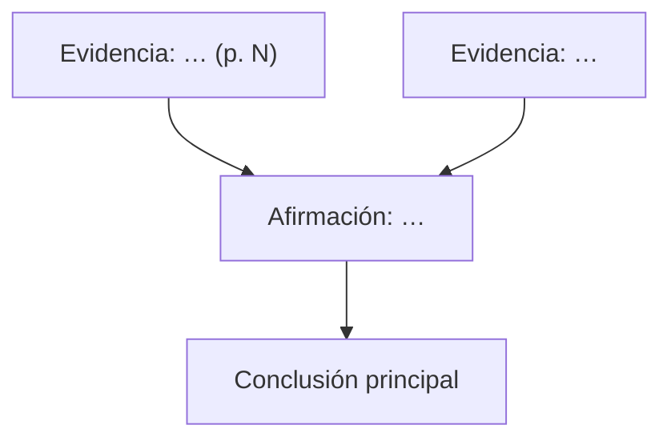

# Plantillas

## `00_mapa.md`
````markdown
# <Título del paper>
<Autores> (<año>), <revista>. DOI/arXiv: … · PDF: <ruta relativa> · BibTeX: `<clave>`
Nivel: <inicial | intermedio | avanzado> · Objetivo: <para qué lo lee el usuario>

## En tres líneas
- **Pregunta:** …
- **Respuesta:** …
- **Evidencia clave:** …

## Mapa conceptual

(Flechas = "hace falta para". Al aprobar un tópico, añadir `class T1 hecho`.)

## Prerrequisitos generales
- <concepto> — por qué hace falta; dónde repasarlo (libro, paper de la carpeta u otra guía)

## Glosario y notación
| Símbolo / término | Significado | Unidades | Dónde aparece |

## Ruta de estudio
- [ ] 01 — <tópico> → [01_<nombre>.md](01_<nombre>.md)
- [ ] 02 — …
- [ ] Síntesis → [99_sintesis.md](99_sintesis.md)

## Registro de repaso
| Pregunta | Último repaso | Resultado | Intervalo (días) | Próximo repaso |
````

## `NN_<nombre>.md` (uno por tópico)
```markdown
# NN — <Tópico>
Cubre: págs …, §…, Figs …, Ecs …

## 1. Qué vas a aprender y por qué importa
## 2. Antes de empezar (prerrequisitos puntuales)
## 3. La idea
Primero en lenguaje llano (2–4 frases, con una analogía si ayuda), luego con rigor, citando página.
## 4. Ecuaciones clave paso a paso
Para cada ecuación: de dónde sale, derivación con los pasos intermedios, significado de cada
término, casos límite y un ejemplo numérico con los valores del paper
(→ `verify.py`, bloque "<nombre>"; incertidumbre y entrada dominante).
## 5. Cómo leer la figura
Ejes y unidades, qué representa cada curva/color, qué mirar primero, qué conclusión saca el
paper. Si se reprodujo: `figuras/figN.png`.
## 6. Afirmación → evidencia
| Afirmación del paper | Evidencia (dato/fig/ec, pág.) | ¿Qué tan sólida? |
## 7. Autoevaluación
1. <pregunta conceptual>
   <details><summary>Pista</summary>…</details>
   <details><summary>Respuesta</summary>…</details>
(3–5 preguntas: al menos una conceptual, una cuantitativa y una de "¿qué pasaría si…?")
```
Omitir las secciones 4 o 5 sólo si el tópico no tiene ecuaciones o figuras. El tutor añade
después `## Mi resumen (<fecha>)` y `## Dudas pendientes`.

## `99_sintesis.md`
````markdown
# Síntesis y lectura crítica

## El argumento en un diagrama


## Supuestos y simplificaciones (y cuándo dejarían de valer)
## Revisión según el tipo de paper
| Punto | Qué hace el paper (pág.) | Evaluación |
## Puntos a verificar (resultado de `verify.py`)
Lo que no se reproduce y por qué; qué entrada domina la incertidumbre de cada resultado.
## Texto frente a código
| Paso o parámetro | Lo que dice el paper (pág.) | Lo que hace el código (archivo:línea) | ¿Coincide? |
## Estado actual del resultado (búsqueda del <fecha>)
| Paper posterior | Relación (confirma / refina / en tensión / refuta / usa) | Qué dice |
## Limitaciones que reconocen los autores / que no reconocen
## Preguntas abiertas e ideas de investigación
## Conexión con el trabajo del usuario y otros papers de la carpeta
## Referencias del paper que vale la pena leer después (y por qué)
````
- Revisión según el tipo: sección **Común** de `checklists.md` más la del tipo detectado.
  Evaluación: ✅ bien resuelto · ⚠️ parcial o discutible · ❌ ausente · — no aplica.
- Texto frente a código: sólo si se revisó el código (ver `investigacion.md`).
- Preguntas abiertas e ideas: 3–5, marcadas con 💡. Para cada una: la pregunta, por qué el
  paper la deja abierta (pág.), qué observación/cálculo/simulación la respondería, cómo se
  conecta con el trabajo del usuario y qué tan factible es.
- Conexión con el trabajo del usuario: mirar el proyecto actual (README, notas, manuscrito)
  y los PDFs vecinos; si no hay contexto, preguntar en vez de suponer.

## `notes/glosario.md` — compartido entre guías
```markdown
# Glosario compartido
| Término / símbolo | Significado | Unidades | Guías (slug, pág.) |

## Conflictos de notación
| Símbolo | Significado en cada guía |
```
Agregar los términos nuevos y añadir el slug a los existentes. Si un símbolo significa otra
cosa que en otra guía, registrarlo en "Conflictos de notación" y advertirlo en `00_mapa.md`.

## `notes/README.md` — índice de la biblioteca
```markdown
# Biblioteca de papers
Actualizado: <fecha>

| Guía | Paper | Progreso | Preguntas para hoy | Próximo repaso |
|---|---|---|---|---|
| [<slug>](<slug>/00_mapa.md) | <Autores, año> | 3/8 tópicos | 2 | <fecha> |

Comparaciones: [<tema>](comparaciones/<tema>.md) · Glosario: [glosario.md](glosario.md)
```
Regenerarlo (no editarlo a mano) al crear una guía y después de cada sesión de tutor,
`quiz` u `hoy`, leyendo cada `notes/*/00_mapa.md`.

## `resumen.md` — modo rápido
```markdown
# <Título> — resumen rápido
<Autores> (<año>), <revista>. DOI: …

- **Pregunta:** … **Respuesta:** … **Evidencia clave:** … (pág.)
- **Método en tres frases:** …
- **Figura clave:** Fig. N (p. N) — qué muestra.
- **Tres limitaciones:** …
- **¿Vale la pena leerlo a fondo?** <sí / sólo §X / no> — por qué, según el objetivo del usuario.
```

## `notes/comparaciones/<tema>.md` — `/leer-paper comparar`
Requiere que cada slug tenga guía; si falta, ofrecer crearla. Leer `00_mapa.md`,
`99_sintesis.md`, `params.toml` y la salida de `verify.py` de cada guía; el PDF sólo cuando
falte un valor.
```markdown
# Comparación: <tema>
Guías: [<slug1>](../<slug1>/00_mapa.md) — <autores, año> · [<slug2>](…) — …

## Pregunta y enfoque
| | <slug1> | <slug2> |
| Pregunta | | |
| Tipo, datos y método | | |
| Supuestos clave | | |
| Resultado principal (± incertidumbre) | | |

## Parámetros en común (de cada `params.toml`)
| Parámetro (unidades) | <slug1> (pág.) | <slug2> (pág.) | ¿Compatibles? |

## Dónde coinciden
## Dónde discrepan y por qué
Para cada discrepancia: causa probable (supuesto, dato, método, época, constante) y qué la
resolvería.
## Qué paper usar para qué
```
Comparar en las mismas unidades; "compatibles" = dentro de las incertidumbres reportadas
(decir cuáles); citar como `(<slug>, p. N)`; si aparece un cálculo a rehacer, añadirlo al
`verify.py` correspondiente.

## `journal_club.md` — `/leer-paper <slug> journal-club`
Preguntar la duración (por defecto 15 min) y el público.
```markdown
# Journal club: <título corto> — <duración>

## Guion
| Minuto | Diapositiva | Qué decir (3 frases máx.) | Figura |
(Contexto → pregunta → método → resultado principal → crítica → discusión.)

## Lo que hay que saber responder
| Pregunta probable del público | Respuesta breve (pág.) |

## Preguntas para abrir la discusión (3–5)
Tomadas de "Puntos a verificar", "Revisión según el tipo" y "Preguntas abiertas".
```

## `referee.md` — `/leer-paper <slug> referee`
Basado en el checklist, `verify.py` y la sección "Texto frente a código". Tono constructivo.
```markdown
# Informe de referee: <título>

## Resumen del trabajo (lo que el paper afirma, en 1 párrafo)
## Evaluación general (originalidad, solidez, claridad)
## Comentarios mayores
1. <problema> — dónde (pág.) — por qué importa — qué se pide a los autores.
## Comentarios menores
## Recomendación: <aceptar / revisión menor / revisión mayor / rechazar> — por qué
```
Dejar claro al usuario que es un ejercicio de lectura crítica, no un informe enviado.
